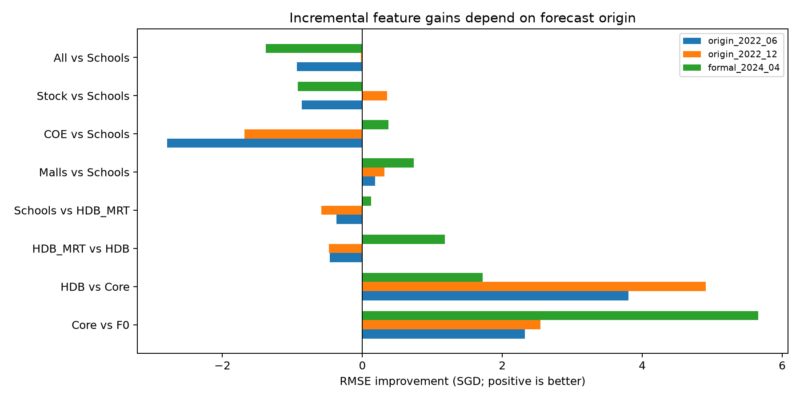
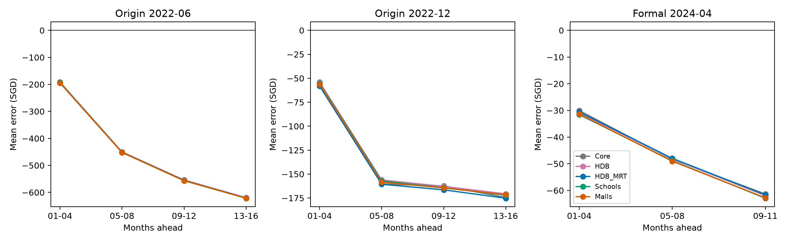
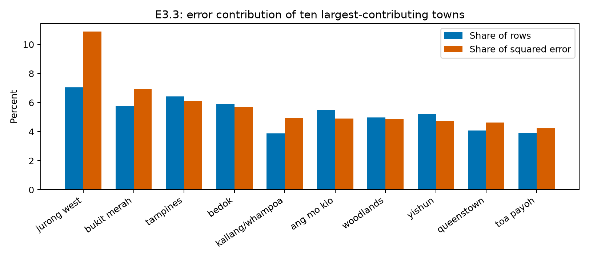

# E5：时间验证、误差分析与整合建议（不含 E4）

## 结论与范围

本轮完成了 9 个固定 LightGBM 特征配置的误差分析：两个原训练期内部的 16 个月固定起点回测共训练 18 个模型，原正式验证期的 9 组预测直接复用。未使用 test.csv，未加入 E4，未调参、校准或训练趋势模型；既有 E2/E3 与附表增量实验的 CSV 通过哈希校验确认未改变。

主要发现是：Core 与 HDB 的增量在三个窗口均为正；MRT、Schools 的增量随时期变化；Malls 对 E3.3 的 RMSE 增益方向一致但很小，MAE 并不总是改善。COE、Stock 和全部附表没有表现出足以支持默认纳入的稳定收益。对于整合，应保留 Core + HDB 作为精简参考，并将 MRT/Malls 作为待比较组件，不能直接把全部有效过的特征拼起来。

时间问题的优先级有所上升：在最早的历史窗口，月度平均偏差约占 E3.3 的 MSE 的 39.46%，而原正式窗口只有 1.20%。可外推趋势加树残差值得进入下一轮小规模对照，但这些诊断本身没有证明某种趋势模型可以准确预测未来。

## 1. 设计与信息边界

| 起点 | 训练期 | 评价期 | 训练行数 | 评价行数 |
|---|---|---|---:|---:|
| 2022-06 | 2021-01–2022-06 | 2022-07–2023-10，16 个月 | 55,008 | 44,893 |
| 2022-12 | 2021-01–2022-12 | 2023-01–2024-04，16 个月 | 70,182 | 47,595 |
| 2024-04（原正式） | 2021-01–2024-04 | 2024-05–2025-03，11 个月 | 117,777 | 31,582 |

历史回测只使用原训练部分。每个起点只训练一次，不用预测区间的真实租金更新模型。低基数 One-Hot、高基数数值 Ordinal 的映射在每折训练部分单独拟合，未知类别按已有编码器规则处理。编码方法沿用此前 E2 的选择，并非重新独立选择。

LightGBM 固定为 `n_estimators=500, learning_rate=0.05, num_leaves=31, random_state=42, n_jobs=-1, verbosity=-1`；数值不缩放，缺失值交给 LightGBM。时间固定为 month_index，未纳入 E4。Mean Error 为预测减真实。

两个历史评价区间重叠，且这是看过正式结果之后设计的回顾性稳健性检查；不能把三个窗口视为独立重复实验，也没有新的完全未触碰测试集。不同起点同时改变训练历史长度、预测期与市场环境，不能把绝对 RMSE 的差异单独归因于预测跨度。没有将三个窗口合并成一个“交叉验证总分”选冠军。

宏观变量按用户暂定的比赛口径，允许使用提供的评价期辅助数据，仍保留 E3 的一个日历月滞后。这与严格预测起点可知的信息集合不同。HDB/POI 是静态快照，没有还原历史状态。报告需要明确上述条件。

## 2. 特征配置及总体结果

所有扩展配置均包含八项 Core：FLOOR_AREA_SQM、flat_age、month_index、TOWN、FLAT_TYPE、FLAT_MODEL、BLOCK、STREET。F0 仅为面积、楼龄、时间、TOWN、FLAT_TYPE。

| 配置 | 2022-06 起点 RMSE | 2022-12 起点 RMSE | 原正式 RMSE |
|---|---:|---:|---:|
| F0 | 795.464 | 618.427 | 485.157 |
| Core | 793.140 | 615.882 | 479.497 |
| Core + HDB | **789.340** | **610.977** | 477.780 |
| Core + HDB + MRT | 789.808 | 611.454 | 476.603 |
| E3.3：继续加 Schools | 790.180 | 612.041 | 476.480 |
| E3.3 + Malls | 789.995 | 611.723 | **475.745** |
| E3.3 + COE | 792.973 | 613.726 | 476.111 |
| E3.3 + Stock | 791.049 | 611.688 | 477.403 |
| All Auxiliary | 791.116 | 612.062 | 477.859 |

HDB 向 Core 增加 LATITUDE、LONGITUDE、MAX_FLOOR、SUBZONE、PLANNING_AREA；MRT 增加最近站距离、名称和线路数；Schools 增加小学/中学距离及 1/2 公里内学校数量；Malls 增加最近商场距离和名称。这里检验的是整组增量，不能据此给每个组内特征排序。

逐项对照的 RMSE 改善（正数更好）：

| 对照 | 2022-06 | 2022-12 | 原正式 |
|---|---:|---:|---:|
| Core 相对 F0 | +2.324 | +2.545 | +5.660 |
| HDB 相对 Core | +3.800 | +4.906 | +1.717 |
| MRT 相对 Core + HDB | −0.468 | −0.478 | +1.177 |
| Schools 相对 Core + HDB + MRT | −0.372 | −0.586 | +0.122 |
| Malls 相对 E3.3 | +0.185 | +0.318 | +0.736 |
| COE 相对 E3.3 | −2.793 | −1.685 | +0.370 |
| Stock 相对 E3.3 | −0.869 | +0.353 | −0.923 |
| All 相对 E3.3 | −0.935 | −0.021 | −1.379 |

Core 相对 F0 在两个历史窗口分别有 16/16、15/16 个月 RMSE 更低；HDB 相对 Core 在两个历史窗口均为 16/16。相比之下，MRT 只有 5/16、6/16 个月改善。Malls 为 9/16、10/16，且第一个历史窗口的 MAE 反而增加约 0.180 SGD。因此 Malls 是小幅候选增量，不能宣称所有指标一致改善或统计显著。

## 3. 时间误差：同样的模型在不同窗口面临不同问题

以下均为 E3.3，按预测跨度统计 Mean Error：

| 起点 | 第 1–4 月 | 第 5–8 月 | 第 9–12 月 | 第 13–16 月 |
|---|---:|---:|---:|---:|
| 2022-06 | −193.51 | −451.70 | −556.25 | −621.39 |
| 2022-12 | −55.37 | −157.19 | −164.24 | −172.01 |
| 原正式 2024-04 | −31.58 | −48.87 | −62.91（仅 9–11 月） | 不适用 |

在 2022-06 起点，RMSE 同时由第 1–4 月的 591.18 增至第 13–16 月的 871.03；在 2022-12 起点，RMSE 则从 643.47 降至 564.46，尽管平均低估加深。因此不能把“低估加深”与“总体误差必然随跨度恶化”混为一谈。

Core、HDB、MRT、Schools、Malls 的偏差轨迹接近，增加空间/配套特征没有解决这个跨时期的平均水平问题。但数据构成变化也会影响均值，这不是概念漂移或租金因果趋势的证明。

对每月预测统一加一个事后最优修正量，可得到下表。修正量由该月真实标签计算，仅用于说明偏差占比；不能报告为可部署模型成绩。

| 起点 | 原 RMSE | 完美逐月平移后的诊断 RMSE | 月度平均偏差占 MSE |
|---|---:|---:|---:|
| 2022-06 | 790.18 | 614.82 | 39.46% |
| 2022-12 | 612.04 | 594.01 | 5.81% |
| 原正式 | 476.48 | 473.61 | 1.20% |

计算使用恒等式：月内平方误差均值 = 月内去均值误差方差 + 月平均误差平方，再按样本量加权。此前“时间整体校正空间约 0.60% RMSE”的判断只适用于原正式窗口，不应外推为项目所有时期的结论。

这支持下一轮检验一个简单趋势加 LightGBM 残差模型，重点检查它能否在历史上涨窗口改善长期偏差，同时在原正式窗口避免过度高估。趋势的窗口、斜率约束及其他参数必须在内部时间验证中决定；不能根据表中真实偏差手动加价。未运行这一模型，不能预先断言收益。

## 4. 原正式验证期的误差集中在哪里

以下以 E3.3 为参考，全部九组配置的同类统计均在 group_errors.csv。不同维度会重复覆盖同一条记录，贡献比例只能在各自维度内部解释，不能跨维度相加。

**租金两端值得优先审查。** 租金分箱边界来自训练集的 25%、50%、75%、90% 分位点，分别为 2000、2500、3100、3600 SGD。在验证集，真实租金不超过 2000 的 1,856 条记录仅占 5.88%，却贡献 32.60% 的平方误差，平均高估约 1006.26；真实租金大于 3600 的记录占 18.86%，贡献 26.00%，平均低估约 446.41。

这与预测向中间收缩一致，但按真实目标分组本身就会产生这种选择效应，不能据此认定存在可用输入能识别的独立“低租金市场”，也不能宣布这些记录错误或删除它们。下一步应检查训练和验证中这些记录的房源属性、时间分布和原始数据含义；若用标签分箱训练分类/分组模型，仍需严格的训练内验证，不能在预测时使用真实租金决定校正。

**少数大误差确实影响 RMSE。** 正式窗口中绝对误差最大的约 1% 记录贡献 16.21% 的平方误差。这是事后误差集中度，既不证明异常标签，也不代表删除这些点能带来有效泛化改善。

**地区差异明显。** Jurong West 有 2,225 条记录，占样本 7.05%，贡献 10.88% 的平方误差，RMSE 592.21、平均低估 121.83。Bukit Merah 占样本 5.75%、误差 6.92%。Punggol 平均高估 51.72，说明不能给所有区域统一加价。Bukit Timah 的 RMSE 达 630.75，但只有 87 条记录，已标记为小样本，不能只按该排名优先建模。

**大户型相对困难。** Executive 占样本 5.10%、误差 7.74%，RMSE 587.03；面积大于 110 平方米的记录占 22.76%、误差 28.54%，RMSE 533.58。这两组可能高度重叠，并非两份独立证据。

**新地址不是总误差的主要来源。** 按训练期 TOWN/BLOCK/STREET 复合地址计数，未见地址只有 131 条，占样本 0.415%，虽 RMSE 为 579.69，平方误差贡献仅 0.614%。训练记录数 1–5 的地址 RMSE 508.09，样本占 8.30%、误差占 9.44%；其余绝大多数误差发生在已有较多训练记录的地址。因此目前没有依据把主要开发精力放在未知地址处理上。

## 5. 除 E4 外，整合应考虑什么

建议保持三个层次，而不是指定尚未充分验证的最终冠军。

| 层次 | 特征与配置 | 理由 |
|---|---|---|
| 固定对照 | F0、Core | 保留解释特征收益的参照 |
| 精简参考 | Core + HDB | 三个窗口均有增量；两个历史窗口最好 |
| 整合候选 | Core + HDB + MRT | 正式期 MRT 有用，历史期略差，需保留对照 |
| 小增量候选 | 上述配置 + Malls | 当前 Malls 只在含 Schools 的条件下测过；去 Schools 后须补一个明确的 E6 对照 |
| 消融参考 | E3.3 及 E3.3 + Malls | 保留既有结果，不把 Schools 自动认定为必选 |
| 暂不默认纳入 | COE、Stock、All | 当前增量方向/指标不一致或整体不利 |

主表八特征本轮作为一个固定整体，未证明其中每一个都必要。不要自动将 composite_block_id 加回：此前它是独立探针，当前没有证明它优于完整 Core 的地址表示。若未来测试替换 BLOCK/STREET，应单列一个受控实验。

当前整合先保持既有编码和 LightGBM 参数，避免同时改变太多因素。CatBoost 和 TabM 应作为后续同输入信息条件下的模型对照，而不是从旧表直接挑 474 的 TabM 为最终模型；本轮没有运行两者，也没有消除此前的特征和早停条件差异。暂不需要大规模参数搜索或集成权重搜索。

下一轮最小实验可以是：先补 Core + HDB + MRT + Malls（不含 Schools），与有/无 Schools 的对应配置比较；再选一个固定房源特征集，做原 LightGBM 与简单趋势加残差的时间回测。随后再将 E4 的候选时间表示接入，避免把两种时间处理的收益混在一起。

## 6. 报告中可以与不可以声称的内容

可以说：HDB 在已检查窗口中提供方向一致的增量；更细的 POI 特征具有时期依赖的边际价值；长期平均偏差在较早窗口更严重；正式期误差明显集中于租金两端和部分房源群体。

不可以说：三个窗口证明统计显著；MRT/Schools 没有预测价值；Stock 必然导致 All 的全部退化；时间外推是所有时期的唯一瓶颈；低租金或大误差记录一定是脏数据；事后完美校正是可实现的预测成绩；已经验证了最终 Kaggle 模型。

当前完整复现入口是 [E5 README](../experiments/error_analysis/README.md)，实现为 [e5.py](../experiments/error_analysis/e5.py)。结果、图和历史预测在同目录下。新增测试检查预测顺序错位、完整未来区间以及分组统计不使用验证标签拟合边界；本轮项目测试共 8 项通过。
