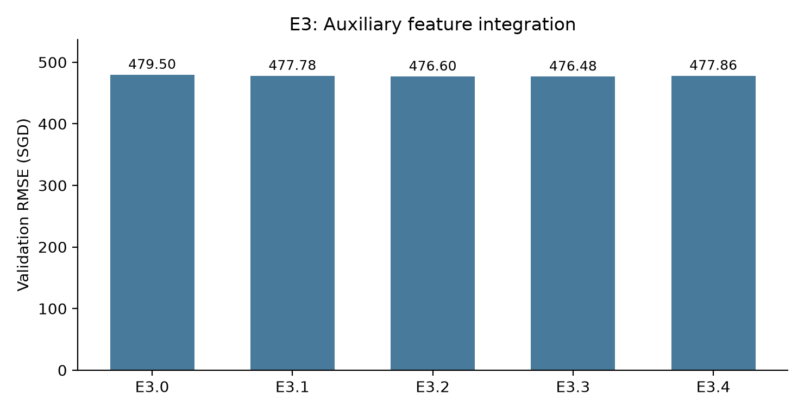
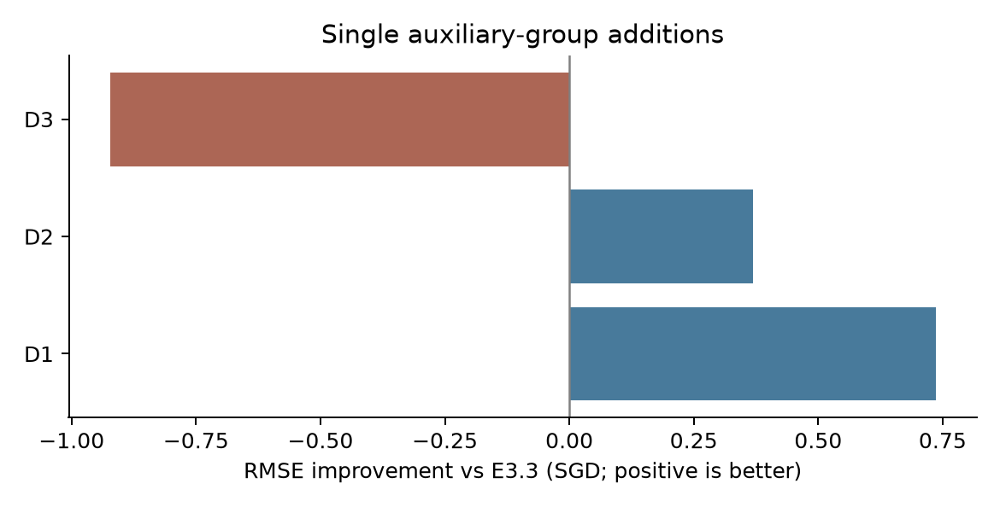

# Feature Engineering 最终分析

## 1. 结论与适用范围

在固定的时间验证集上，位置与建筑信息提供了明确但幅度有限的增量价值：HDB 和 MRT 改善了主表模型；Schools 与 Malls 仅带来很小的进一步改善。Stock 单独加入 E3.3 后，各项主要误差指标均变差，但不能据此把 All Auxiliary 的全部退化归因于 Stock。当前证据更支持保留精简、可解释的特征组合，而不是认为“附表越多，预测越好”。

这些结论来自同一验证期的描述性比较，不是统计显著性、因果效应或跨时期稳定性的证明。编码选择及后续诊断反复使用同一验证期，也意味着最优分数存在选择偏差。正式 E2/E3 结果和统一编码均未在整理中更改。

## 2. 统一实验条件与结果

所有正式实验采用相同的数据清洗、2021-01 至 2024-04 的训练期（117,777 条）、2024-05 至 2025-03 的验证期（31,582 条）、LightGBM 参数和评价指标。低基数类别使用训练集拟合的 One-Hot；高基数类别使用数值 Ordinal；数值不缩放，缺失值交给 LightGBM。未使用 test.csv。

模型为 `LGBMRegressor(n_estimators=500, learning_rate=0.05, num_leaves=31, random_state=42, n_jobs=-1, verbosity=-1)`。Mean Error 定义为预测值减真实值。

| 实验 | 特征变化 | RMSE | 相对对照组改善 | 改善百分比 |
|---|---|---:|---:|---:|
| E2.0 | 原始五特征 F0 | 485.157 | — | — |
| E2.1 | F0 + FLAT_MODEL | 484.367 | 0.790 | 0.163% |
| E2.2 | F0 + STREET | 481.023 | 4.134 | 0.852% |
| E2.3 | F0 + composite_block_id | 482.756 | 2.401 | 0.495% |
| E2.4 | F0 + 经纬度 | 479.446 | 5.711 | 1.177% |
| E2.5 / E3.0 | 八特征 Core | 479.497 | 5.660（对 E2.0） | 1.167% |
| E3.1 | Core + HDB | 477.780 | 1.717（对 E3.0） | 0.358% |
| E3.2 | 继续加入 MRT | 476.603 | 1.177（对 E3.1） | 0.246% |
| E3.3 | 继续加入 Schools | 476.480 | 0.122（对 E3.2） | 0.026% |
| E3.4 | 继续加入 Malls、COE、Stock | 477.859 | −1.379（对 E3.3） | −0.289% |

E2.1–E2.4 是分别向 F0 增加特征，并非逐步累加；因此 E2.4 的经纬度收益不能直接解释为 HDB 加在完整 Core 上的收益。E3.0 与 E2.5 的特征、编码和四项指标一致，预测差异仅在浮点读写精度内。

## 3. 为什么 HDB 有帮助

**实验证据。** 在已经包含 TOWN、BLOCK、STREET、FLAT_MODEL 等信息的 Core 上，加入 HDB 仍使 RMSE 从 479.497 降到 477.780。HDB 增加 LATITUDE、LONGITUDE、MAX_FLOOR、SUBZONE、PLANNING_AREA。E2.4 也表明，仅向 F0 增加经纬度，就能带来 5.711 SGD 的 RMSE 改善。

**最合理的解释。** TOWN 只提供较粗的位置分组；街道和楼号主要以类别标签表示。坐标让模型能够在连续地理空间上划分相邻区域，跨越不同地址标签共享区位信息。MAX_FLOOR 增加建筑尺度信息，而 SUBZONE/PLANNING_AREA 提供不同粒度的行政区位表示。这些信息可帮助模型捕捉原始地址编码难以高效表达的租金差异。

E3.3 的训练增益重要性中，LATITUDE 占 9.19%、LONGITUDE 占 1.41%、MAX_FLOOR 占 3.48%，说明模型实际使用了这些特征。但训练重要性不是独立贡献或因果效应：本轮只验证了 HDB 整组的增量，尚未把建筑、坐标和行政区划逐项分离；MAX_FLOOR 也不是房源实际所在楼层，不能解释为已观测到单套房屋的高楼层溢价。

## 4. 为什么 MRT 在 HDB 之后仍有帮助

**实验证据。** 加入 MRT 后，RMSE 从 477.780 降到 476.603，改善 1.177 SGD。新增特征是最近站距离、站名和该站线路数。由于这一步模型已经拥有 HDB 经纬度，结果支持 MRT 特征在已有坐标之外仍有额外的预测价值。

**最合理的解释。** 经纬度描述“在哪里”，MRT 特征把位置转换为具有交通含义的可达性表示。由一系列经纬度阈值去逼近“离最近车站多远”通常需要更多树切分；显式距离把这部分空间关系预先表达出来，可能降低固定树容量下的学习难度。站名还可能代理不同交通节点及周边区域的差异，线路数表达换乘连接程度。

这是表示效率与交通可达性的合理解释，不是已证明的因果机制。整组收益不能确定距离、站名、线路数各自贡献多少，也不能证明靠近 MRT 导致租金增加；站名同时包含其他区位信息。

## 5. 为什么 Malls 的提升很小

| 增量实验 | RMSE | MAE | R² | Mean Error | 相对 E3.3 的 RMSE 改善 |
|---|---:|---:|---:|---:|---:|
| E3.3 | 476.480 | 353.609 | 0.4767 | −46.235 | — |
| D1：E3.3 + Malls | 475.745 | 352.944 | 0.4784 | −46.175 | +0.736（0.154%） |
| D2：E3.3 + COE | 476.111 | 353.698 | 0.4776 | −48.552 | +0.370（0.078%） |
| D3：E3.3 + Stock | 477.403 | 355.099 | 0.4747 | −51.213 | −0.923（−0.194%） |

**实验证据。** Malls 单独加入后，RMSE 和 MAE 都略有改善，因此不能说商场数据“没有用”。但 0.736 SGD、约 0.154% 的改善很小，只能称为本验证期的小幅增量，不能声称是稳定或具有显著实际价值的收益。85 个训练期最近商场类别在验证期没有未知类别，因此大规模未知类别编码失败不支持作为其收益偏小的主要解释。

**可能解释。** 商场距离和名称可能与模型已有的街道、坐标、MRT 等区位表示共享信息；其新增信息自然小于从粗位置表示首次加入坐标的收益。同时，当前特征只描述最近商场及距离，没有刻画商场规模、质量、步行路线、商圈数量或服务差异，可能不足以表达完整商业配套价值。

这两点仍是假设。本轮地理特征间的简单相关性并不强，不能仅凭相关矩阵断言“商场信息已完全被 MRT 替代”；低线性/秩相关也不能排除非线性信息重叠。亦未执行同等设置下的商场表示对照或条件重要性分析。最稳妥的结论是：**现有商场表示在 E3.3 之上的边际预测收益有限。**

## 6. 为什么 Stock 可能降低性能

**实验证据。** Stock 单独加入后，RMSE 增加 0.923 SGD，MAE 增加约 1.490 SGD，Mean Error 从 −46.235 变成 −51.213，低估进一步加重。All Auxiliary 的 RMSE 更差，但 D3 只衡量 Stock 加在 E3.3 上的作用；它不是从完整 E3.4 去掉 Stock 的实验，不能证明 Stock 导致全部退化。

存在两项有数据支持的风险：

1. **独立时间信息有限且与时间趋势相关。** 滞后 Stock 在训练期只有 39 个非缺失月度值，尽管它在十多万条房源中重复出现。它与 month_index 的训练期月度 Spearman 相关系数为 0.762，可能主要充当市场时间代理，而不是新增单套房源的差异信息。相关性本身不能证明其无用；同月宏观变量仍可能帮助刻画市场环境。
2. **验证期超出训练数值支持范围。** 约 70.99% 的验证房源对应 Stock 值高于训练范围。树模型使用已学得的数值阈值划分，不会因为指标继续上涨就自动进行线性外推。该特征在训练期形成的租金关联未必能用于验证期更高的指数区间。

**尚未验证的机制。** Stock 可能与时间特征竞争切分，或把训练期特有的宏观关联带入之后的月份，从而降低泛化表现。多个新增特征共同加入时，模型会重新分配切分，单独增量不能简单相加。这些解释与观察一致，但尚未隔离证明；不能把股价与租金的经济关系、过拟合或概念漂移视为定论。

COE 的结果也提醒我们区分指标：D2 的 RMSE 略有改善，但 MAE 和负偏差略有恶化。宏观特征的作用并非所有指标一致，更不能用 All Auxiliary 的一个分数概括每张附表。

## 7. 为什么整体 Feature Engineering 的收益有限

第一，主表 Core 已经拥有面积、户型、楼龄、时间和地址，能够解释相当一部分可观测差异。HDB/MRT 在其上继续改善，但之后增加的特征是在更丰富的对照组上争取边际收益。E3.3 相对 Core Only 的 RMSE 改善为 3.016 SGD，约 0.629%；新增信息是否与已有表示重叠仍需针对性验证，不能只由收益小推导出完全冗余。

第二，模型存在直接验证过的时间表示限制。month_index 在 E3.3 中占训练切分增益的 53.51%，但训练月份范围为 0–39，验证月份为 40–50。固定其他输入时，把验证月份改为 39、40 或 50 都不会改变预测。这说明时间特征在训练范围外饱和，而不是模型完全没有使用时间。

验证期 11 个月的 Mean Error 均为负，首月约 −3.18、末月约 −76.95；但 RMSE 从约 506.65 降至 457.19，中间也有波动。因此“平均低估加深”与“总体 RMSE 持续变坏”是不同判断，后者没有得到支持。时间外推受限可能贡献了低估，但租赁样本构成、未观测属性及条件关系变化也可能有作用；不能仅凭负 Mean Error 宣称存在 Concept Drift。

第三，编码和数据粒度有边界。编码对照确实启用了 Native 类别切分，但在 E2.5 上数值 Ordinal 的 RMSE 最低（479.497，Frequency 为 479.806，Native 为 482.635），因此保留原选择合理。该比较只覆盖 BLOCK/STREET，不证明附表类别也最适合 Ordinal。数值 Ordinal 对名义类别施加人为顺序；composite_block_id 虽然唯一，中位数却仅有 10 条训练记录/类别，稀疏性也是潜在限制。目前尚未证明二者是主要瓶颈，不能据此直接改变正式编码。

## 8. 数据可用性限制与最终建议

COE/Stock 均沿用一个完整日历月滞后：租金月份 t 使用 t−1 月聚合值。2021-01 没有 2020-12 来源，保留 NaN，不用未来数据回填。准确发布日期、股票历史调整版本及来源股票池的历史完备性无法从快照确认。HDB、MRT、Schools、Malls 使用允许的静态地理近似，没有还原历史运营状态。这些限制没有在整理或诊断中被消除。

**正式结论：** HDB/MRT 的现有表示在固定验证期具有正向增量价值；Schools/Malls 的进一步收益小；Stock 的单独增量结果不利；All Auxiliary 不能视为最佳特征集合。正式 E3.3 保持原定义，D1 仅作为分开保存的诊断结果，不能因本次小幅领先自动取代正式方案。

**如果进行下一轮，优先两件事：** 在训练期内部的滚动时间验证中，检查可外推的时间趋势加树残差模型；同时比较 E3.3 与加入 Malls 的精简方案，检验收益及 Stock 负面效果是否稳定。所有趋势、校准和选择均只能使用各折训练数据，不用当前验证集目标修正预测。暂不推荐开展大规模调参或全面替换高基数编码。

## 9. 结果入口

- [实验目录与复现说明](../experiments/feature_engineering/README.md)
- [E2 完整结果](../experiments/feature_engineering/results/e2_results.csv)
- [E3 完整结果](../experiments/feature_engineering/results/e3_results.csv)
- [附表独立增量结果](../experiments/feature_engineering/results/diagnostics/incremental_results.csv)
- [逐月误差](../experiments/feature_engineering/results/diagnostics/monthly_errors.csv)
- [训练特征重要性](../experiments/feature_engineering/results/diagnostics/e33_feature_importance.csv)
- [时间特征范围](../experiments/feature_engineering/results/diagnostics/temporal_feature_ranges.csv)

